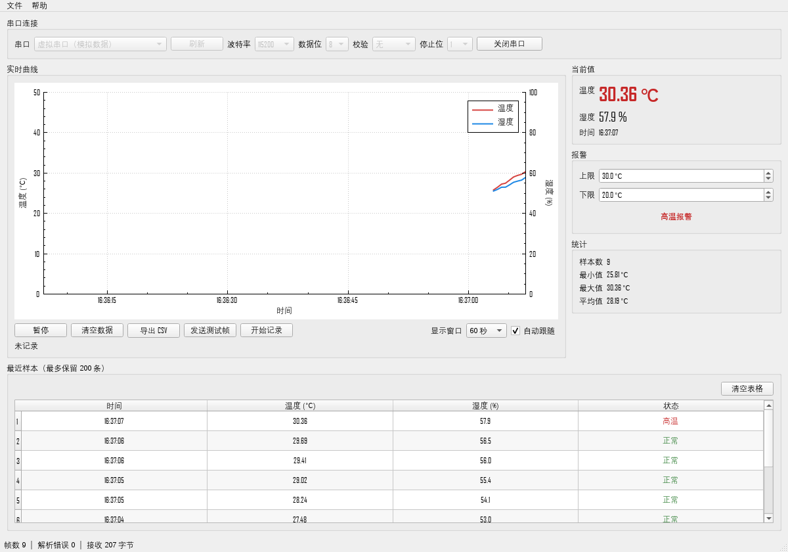

# SerialTempMonitor

一个基于 **Qt 6 + QSerialPort + QCustomPlot** 的串口温度监控上位机。

灵感来自常见的“串口温度采集”例程，但把通信、协议解析、绘图和存盘重新做了分层：
串口读取用 `readyRead` 事件驱动，后台线程只负责写文件，绘图放在界面线程用 QCustomPlot 完成。



## 功能

- **串口管理**：自动枚举可用串口、刷新、显示设备描述；支持波特率、数据位、校验位、停止位配置。
- **协议解析**：自定义 ASCII 帧格式，带 XOR 校验；正确处理半包、粘包、帧前杂字节和坏帧。
- **实时曲线**：温度（左轴）与湿度（右轴）双曲线，时间轴自动滚动，可暂停/继续、清空、切换显示窗口（30/60/120/300 秒）。
- **报警**：可设置温度上下限，超限时界面变色提示。
- **统计**：样本数、最小值、最大值、平均值。
- **数据表格**：最近 200 条采样，含时间、温度、湿度和报警状态。
- **CSV 导出**：把当前内存中的历史数据导出为 CSV（UTF-8 BOM，Excel 直接打开）。
- **后台记录**：独立 `QThread` 按条写入 CSV，每 20 条刷盘，不阻塞界面。
- **虚拟串口**：端口列表中的“虚拟串口（模拟数据）”和真实串口一样需要打开，通过同一个 `dataReceived` 信号送数据，不需要 com0com 等驱动。
- **发送测试帧**：向当前串口写入一帧测试数据；配合 CH340 短接 TX-RX 可做硬件回环自检。
- **自动跟随**：默认跟随最新数据；拖动或缩放图表会自动关闭，勾选“自动跟随”立即回到最新。
- **配置持久化**：串口参数、报警阈值、显示窗口、自动跟随状态通过 `QSettings` 记忆。

## 界面

```
┌─────────────────────────────────────────────────────────────┐
│ 串口 [COM3 (USB-SERIAL CH340)] 刷新  波特率 [115200] ...     │
├───────────────────────────────────────────┬─────────────────┤
│ 实时曲线                                   │ 当前值           │
│  温度(左轴)/湿度(右轴)                     │  温度 23.50 ℃    │
│                                           │  湿度 45.2 %     │
│  [暂停][清空数据][导出CSV][开始记录] 窗口▾ │ 报警 上限/下限   │
│                                           │ 统计 样本/最小…  │
├───────────────────────────────────────────┴─────────────────┤
│ 最近样本（最多 200 条）                                      │
│  时间      温度(℃)   湿度(%)   状态                         │
└─────────────────────────────────────────────────────────────┘
```

## 串口帧格式

一行一帧，ASCII 编码：

```
$D,T=23.50,H=45.20*37\r\n
│   │             │  └── 帧结尾
│   │             └───── * + 两位十六进制校验
│   └─────────────────── 载荷：T=温度（必选），H=湿度（可选）
└─────────────────────── 帧头
```

- 校验值 = 载荷每个字节做 XOR，再转成两位大写十六进制。
- 湿度字段可以省略，例如 `$D,T=23.50*43`。
- 解析器还会处理：一次收到多帧、一帧被拆成两次、帧前有垃圾字节、校验错误、超长无换行（4096 字节上限）。

模拟器通过同一个 `FrameCodec::encode()` 生成数据，所以“模拟模式”和“真实串口模式”走的是完全相同的解析与显示流程。

## 目录结构

| 文件 | 作用 |
|---|---|
| `main.cpp` | 程序入口；`--selftest` 用于自动退出的冒烟测试 |
| `mainwindow.h/.cpp/.ui` | 主窗口：界面、事件绑定、曲线、表格、报警、导出 |
| `serialmanager.h/.cpp` | `QSerialPort` 封装：枚举、打开/关闭、`readyRead`、错误处理 |
| `framecodec.h/.cpp` | 帧编码/解码/校验 |
| `frameparser.h/.cpp` | 接收缓冲区、粘包/半包处理、错误统计 |
| `transport.h` | 数据源统一接口（真实串口 / 虚拟串口） |
| `virtualserialport.h/.cpp` | 程序内部的虚拟串口，负责生成模拟数据 |
| `statistics.h/.cpp` | 温度统计 |
| `recorder.h/.cpp` | `QThread` + `moveToThread` 的异步 CSV 记录 |
| `sample.h` | 一次采样的数据结构 |
| `qcustomplot.h/.cpp` | 第三方绘图库（QCustomPlot 2.0.0，GPLv3） |
| `tests/` | Qt Test 单元测试 |

## 构建

要求：CMake ≥ 3.21、Qt ≥ 6.5（需要 `Core Gui Widgets SerialPort PrintSupport Test`）。

```bat
cmake -S . -B build -G Ninja -DCMAKE_PREFIX_PATH=D:/Qt/6.11.1/mingw_64
cmake --build build -j
```

如果使用 MSVC 套件，把 `CMAKE_PREFIX_PATH` 换成 `D:/Qt/6.11.1/msvc2022_64` 即可。

运行前确保 Qt 的 `bin` 目录在 `PATH` 中，或用 `windeployqt` 拷贝依赖 DLL。

## 运行

1. 没有硬件：在串口下拉框里选择“虚拟串口（模拟数据）”，点“打开串口”，即可看到完整流程；它同样会走打开/关闭和 `dataReceived` 处理。
2. 有硬件：选择串口和参数 → “打开串口”。设备按上面的帧格式发送数据即可。
3. 点“开始记录”选择 CSV 保存位置，程序会在后台线程持续写盘；点“导出 CSV”可导出当前内存中的历史数据。

## 用 CH340 实测（硬件回环）

CH340 是 USB 转 TTL 串口，插上并装好驱动后，设备管理器里会出现“USB-SERIAL CH340 (COMx)”。

1. **回环测试**：用一根杜邦线把 CH340 的 TX 和 RX 短接。
2. 打开程序，选择该 COM 口，参数用 115200 / 8 数据位 / 无校验 / 1 停止位，点“打开串口”。
3. 点“发送测试帧”。写出的帧会被短接线原样送回，曲线和表格出现一个新点，状态栏提示已发送。
4. **接真实设备**：CH340 TX → 设备 RX，CH340 RX → 设备 TX，GND 共地；设备按上面的帧格式发送即可。

注意：CH340 输出的是 TTL 电平（3.3V/5V），不要直接接 RS232 的 ±12V；接 RS232 设备需要 MAX3232 之类的电平转换。

## 测试

```bat
ctest --test-dir build --output-on-failure
```

- `tst_framecodec`：编解码往返、校验错误、半包、粘包、垃圾字节、缺少温度字段、湿度可选、缓冲区溢出。
- `tst_datamodel`：统计计算、缺失温度处理、后台记录写出的 CSV 内容。

无显示器环境下的启动检查：

```bat
set QT_QPA_PLATFORM=offscreen
build\SerialTempMonitor.exe --selftest
```

自动打开虚拟串口并在 5 秒后截图（用于生成界面预览）：

```bat
set QT_QPA_PLATFORM=offscreen
build\SerialTempMonitor.exe --demo --screenshot=preview.png
```

## 设计要点

1. **串口不需要线程**：`QSerialPort::readyRead` 本身是异步的，`readAll()` 很快返回；把串口放进线程反而增加同步成本。
2. **线程只做重活**：只有频繁写文件放到 `QThread` 里，通过队列连接传递时间/温度/湿度三个基础类型，避免自定义类型跨线程注册。
3. **解析器独立**：`FrameParser` 只依赖字节流，不碰界面和串口，因此可以单独做单元测试。
4. **内存有上界**：曲线只保留最近 10 分钟数据，表格 200 行，历史最多 50000 条，避免长时间运行内存无限增长。
5. **暂停只停绘图**：暂停时仍然接收、统计、写盘，恢复后一次重绘，数据不会丢。
6. **真实/虚拟串口共用一条链路**：`Transport` 接口把“打开/关闭/收到数据/状态变化”统一起来，`SerialManager` 和 `VirtualSerialPort` 都实现它，界面和解析层不需要区分数据来源。虚拟串口只模拟串口行为，不占用系统 COM 口；它的 `write()` 会把数据原样回送，因此“发送测试帧”在虚拟串口上也能直接验证。如果想让 `QSerialPort` 本身体验回环，需要安装 com0com 建立一对虚拟串口，或者用 CH340 短接 TX-RX。

## 可以继续扩展

- 把协议换成 Modbus RTU（`QModbusRtuSerialClient`）。
- 接入 MySQL/SQLite 保存历史数据，做按时间段查询。
- 支持多设备/多串口，每个设备一条曲线。
- 增加 TCP 客户端模式，和串口共用同一套解析与显示。

## 许可

`qcustomplot.h/.cpp` 为 QCustomPlot 2.0.0，遵循 GPLv3（或向作者购买商业授权）；其余代码可自由用于学习。
